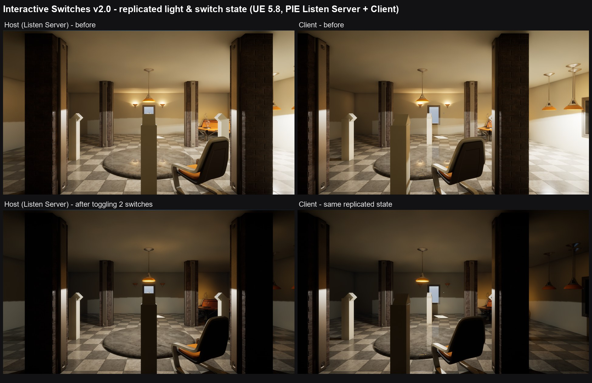
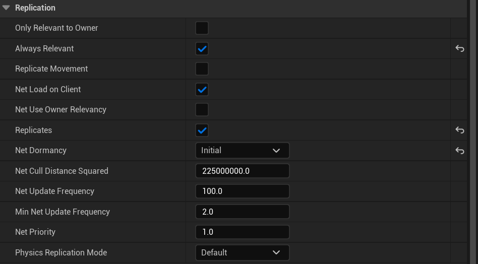
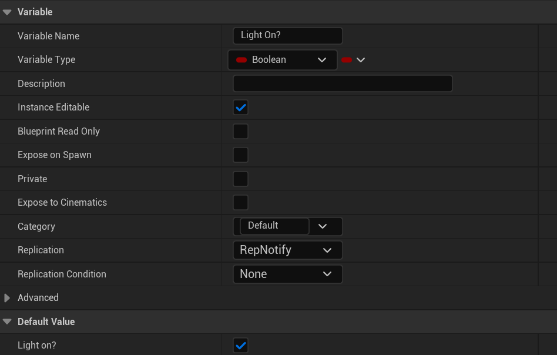
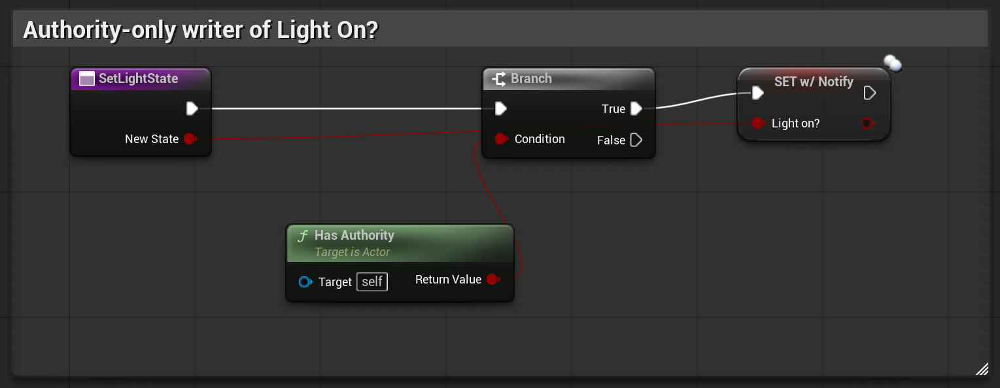
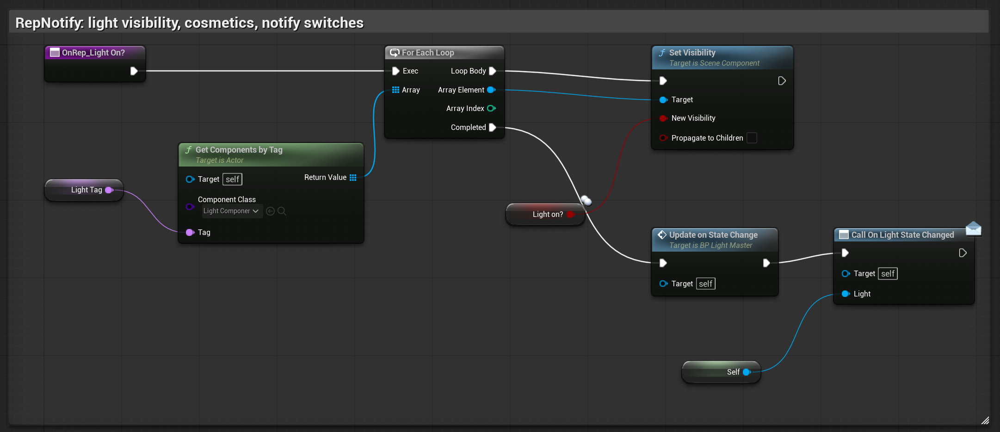
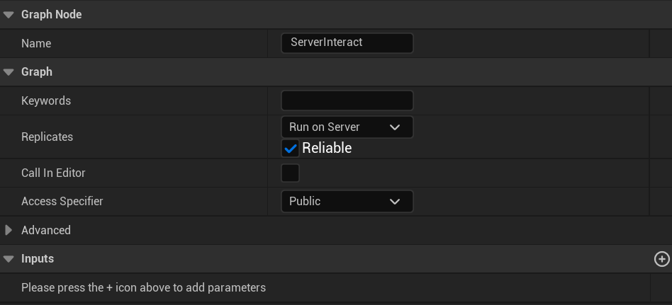
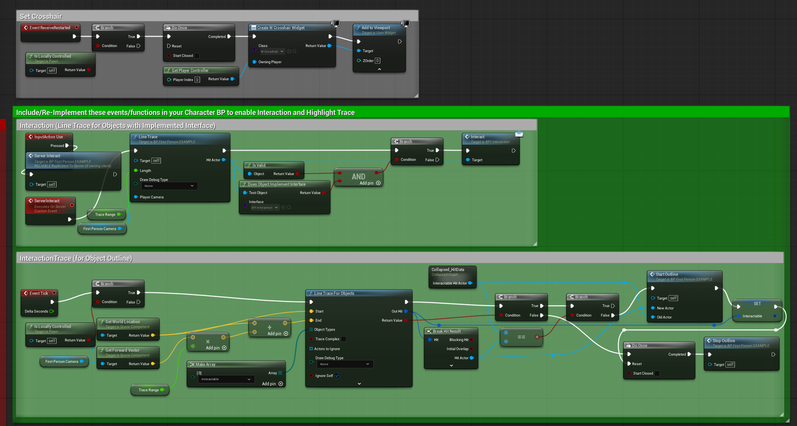
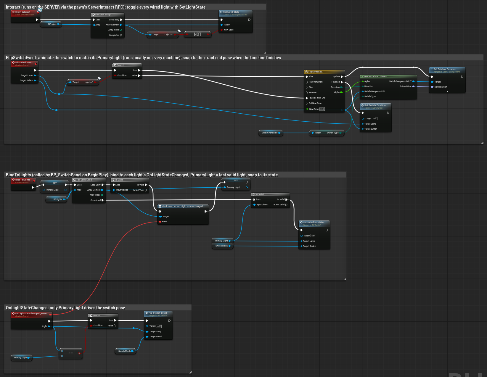
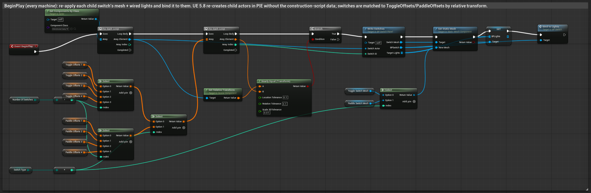

# Interactive Switches

Interactive Switches is an Unreal Engine asset package for building and customizing a lighting system from a variety of light sources and meshes. The included Switch Plates and Switches work independently, and each one can be 'wired' to as many lights as you need, including lights with different component types, just like a real-world room.

With the closure of the Unreal Engine Marketplace, this product can now be found on FAB:
https://www.fab.com/listings/689ab427-0aca-4599-a1d3-7b3d9e8c56cf

---------------------
 * Versions (v1.0 vs v2.0)
 * Technical Information
 * First Steps/Setup
 * How to Create a Compatible Light
 * How to Configure Your Light Switch
 * How to Use Your Light Switch
 * Multiplayer / Network Replication (v2.0, UE 5.8+)
 * Changelog

VERSIONS (v1.0 vs v2.0)
=======================
| | v1.0 | v2.0 |
|---|---|---|
| Engine versions | All engine versions **prior to UE 5.8** | **UE 5.8** (implemented and tested on 5.8.4) |
| Networking | Single-player / standalone only. Nothing is replicated. | Server-authoritative network replication (Listen Server, Dedicated Server, late joiners) |
| Light state | `Light On?` is set directly by the switch | `Light On?` is a **RepNotify** variable that is only written through `SetLightState` (authority only) |
| Visual updates | The switch toggles light visibility and calls `UpdateOnStateChange` itself | `OnRep_Light On?` applies visibility, calls `UpdateOnStateChange`, and fires the `OnLightStateChanged` dispatcher on every machine |
| Example character | The `Use` input traces and calls `Interact` locally | The `Use` input calls the `ServerInteract` RPC. The server traces and calls `Interact` |
| Switch animation | Follows the last light toggled by the interaction | Follows the switch's **PrimaryLight** (the last light assigned to it), and snaps to the exact final pose |
| Switch panels | All setup happens in the construction script | Setup is re-applied on `BeginPlay`, so switches work in UE 5.8 Play-In-Editor (child actors are re-created in PIE) |

> **Implementation gap:** v2.0 is only published for UE 5.8. If you use an earlier engine version you receive v1.0, which has **no replication**. Lights and switches toggled by a client will not update for other players. All sections below apply to both versions unless they are marked **(v2.0)**.

TECHNICAL INFORMATION
=====================
    Features:
        Fully Configurable and Customizable
        Imitate real-life light switch functionality
        Interaction system with post-process outline functionality;
        Includes two classic switch types, with each plate supporting up to 4 switches;
        Each switch is capable of supporting multiple light actors and multiple light types;
        Clean and Organized Blueprints with Functionality Comments;
        Parent Blueprint for crafting additional environment lights;
        Master Blueprints for Switch Plates and Independent Light Switches;
        Example Blueprints of controllable environment lights;
        (v2.0) Network Replicated: server-authoritative light state, replicated to all clients and late joiners;

    Components:
        Number of Blueprints: 8
        Number of Blueprint Interfaces: 1
        Number of Blueprint Game Modes: 1
        Number of Blueprint Characters: 1
        Number of Widget Blueprints: 1 (crosshair, example only)
        Number of Enumerations: 2
        Number of Maps: 1 (ExampleMap)
        Number of Unique Meshes: 25
        Number of Materials and Material Instances: 27
        Number of Material Functions: 3
        Number of Textures: 55 (v1.0) / 54 (v2.0, one unused example texture removed)
        Texture Resolutions: 1024x1024 / 2048x2048 (plus a tiny UI crosshair texture)

    Input: Keyboard, Mouse
    Network Replicated: No (v1.0) / Yes (v2.0)
    Supported Development Platforms: Windows, Mac (v1.0); Windows (v2.0, tested)
    Supported Engine Versions: prior to 5.8 (v1.0); 5.8 (v2.0)
    Code: Blueprint only, no C++ and no plugins required

FIRST STEPS/SETUP
=================
- The Blueprint functions required for Interaction/Object Outlines are in BP_FirstPerson_EXAMPLE.

- When you integrate with an existing project, copy and/or merge these into your own character.
  - **(v2.0)** You must also copy the `ServerInteract` custom event (Replicates: *Run on Server*, *Reliable*). See [Multiplayer / Network Replication](#multiplayer--network-replication-v20-ue-58).

- **(Required)** In Project Settings, under Engine/Input, add an 'action mapping' named "Use". You can bind it to any key.

	

- **(Required)** In Project Settings, under Engine/Collision, create a 'New Object Channel' named "Interactable" with 'Default Response' set to "Block".

	

- **(Optional)** To enable the object outline, attach the Post Process Material "MI_Outliner" to your Post Process Volume.

	

HOW TO CREATE A COMPATIBLE LIGHT
================================
    Refer to the included example Light BPs if you are unsure of the setup process below.

1. Locate the BP_Light_Master Blueprint.

2. Right-click it and choose 'Create Child Blueprint Class'.

3. Add any Static Meshes, Light Sources, Audio Components, etc. that your new Blueprint needs.

	The names of these components do not matter as far as the light switch functionality is concerned.

4. Switch to the Construction Script tab of your Blueprint.

	**(REQUIRED)** Make sure the 'Parent: Construction Script' node is present. If it is missing, your lights will not be tagged automatically.

5. Make any changes you want to the Construction Script AFTER the execution pin of 'Parent: Construction Script'.

6. Switch to the Event Graph tab of your Blueprint.

	**(OPTIONAL)** If your light needs other changes when its state changes, such as materials or sounds, implement the Event "UpdateOnStateChange" and customize it as needed.

	**(v2.0)** "UpdateOnStateChange" runs on the server AND on every client (it is called from the RepNotify). Keep it cosmetic: materials, sounds, particles. Read the replicated "Light On?" value inside it. Never set "Light On?" directly. Call "SetLightState" (server only) instead.

HOW TO CONFIGURE YOUR LIGHT SWITCH
==================================
1. Place your new light actor in your level.

2. (Optional) Set the light's status.

3. Add a light switch to your level by placing the BP_SwitchPanel actor in your scene.

4. Configure your Switch Settings.

Choose the number of switches and the style/type.

Add Element(s) to the assignment variable.

Pick a Light Actor from your scene and assign it a switch number (0 - 3).

		    You can attach multiple light actors to a single light switch. However:
		    NOTE: To attach a light actor to this asset, it MUST be a Child Blueprint Class of BP_Light_Master.

	**(v2.0)** When a single switch controls several lights, the switch lever always shows the state of its **PrimaryLight**, which is the last light assigned to that switch. Every light still toggles. If the lights are in different states, only the primary one decides the lever position. This keeps the lever identical for every player.

HOW TO USE YOUR LIGHT SWITCH
============================
1. Play your level in the selected Viewport (or a PIE window), aim at a light switch, and press the key you bound to your "Use" action mapping.

    If everything is configured correctly, the switch highlights/outlines (if Post Process Materials are enabled). When you interact with it, the switch and its light(s) toggle between ON and OFF and run any additional code you added in your Child classes.

MULTIPLAYER / NETWORK REPLICATION (v2.0, UE 5.8+)
=================================================
    v2.0 only. The v1.0 builds for engine versions prior to 5.8 are not replicated.

**How it works**

- The server owns every light's state. A client's "Use" input sends a reliable **Run on Server** RPC (`ServerInteract`). The server does the line trace with the player's control rotation and calls `Interact` on the switch it hits.
- `BP_Switch::Interact` calls `SetLightState(NOT Light On?)` on each light wired to it. `SetLightState` only does something on the server (`Has Authority`).
- `Light On?` is a **RepNotify** variable. `OnRep_Light On?` runs on the server and on every client. It shows/hides the tagged light components, calls `UpdateOnStateChange`, and broadcasts `OnLightStateChanged`.
- Switches are **not** replicated actors. Each one listens to its lights' `OnLightStateChanged` and animates locally, so every machine (including late joiners) ends up in the same state.
- Light replication defaults (BP_Light_Master Class Defaults): `Replicates = true`, `Always Relevant = true`, `Net Dormancy = Initial`. The light stays dormant until it changes, so it costs no bandwidth while idle.

**Replication settings on BP_Light_Master**

**Integrating with your own character (required for multiplayer)**

1. Copy the interaction logic from `BP_FirstPerson_EXAMPLE` (see the green "Include/Re-Implement" comment).
2. Create a custom event named `ServerInteract`. In its Details panel set **Replicates: Run on Server** and tick **Reliable**.
3. Bind your "Use" input to call `ServerInteract`. Inside `ServerInteract`, trace from the camera **using Get Control Rotation** for the direction. The camera component's rotation is not updated on the server for other players' pawns. If the hit actor implements `BPI_Interaction`, call `Interact`.
4. Gate any per-player cosmetic logic (outline trace on Tick, HUD/crosshair widgets) with `Is Locally Controlled`. In the example, the crosshair is created from `Event Restarted` → `Is Locally Controlled` → `Do Once`.

**Switch logic (BP_Switch and BP_SwitchPanel)**

**Rules for your own content**

- Only call `Interact` on the server.
- Never set `Light On?` directly. Use `SetLightState`.
- Keep `UpdateOnStateChange` cosmetic. It runs on every machine.
- Switch Panels must stay level-placed actors. Their switches are rebuilt locally on `BeginPlay`.

**Testing in the editor**

1. Play → Net Mode: **Play As Listen Server** (or **Play As Client** for a dedicated server), Number of Players: **2**.
2. Toggle switches from both the host and the client window. Lights, switch levers and glow materials should match on every window.
3. If you recompile `BP_Switch` or `BP_SwitchPanel`, reopen the map before pressing Play.

CHANGELOG
=========
**v2.0 (UE 5.8)**
- Added server-authoritative network replication. Light state is a RepNotify variable, light actors replicate with Initial dormancy, and late joiners receive the current state.
- Added `SetLightState` (authority-only) and the `OnLightStateChanged` event dispatcher to `BP_Light_Master`.
- `BP_Switch` now animates from replicated light state. Multi-light switches follow their PrimaryLight. The timeline snaps to the exact final pose at any frame rate.
- `BP_SwitchPanel` re-applies switch setup on `BeginPlay`, which fixes switches losing their mesh and lights in UE 5.8 Play-In-Editor.
- `BP_FirstPerson_EXAMPLE`: the `Use` input now goes through the `ServerInteract` RPC, the outline trace and crosshair are local-player only, and the server trace uses the control rotation.
- Project: the default Game Mode now points to `BP_GameMode_EXAMPLE`, ExampleMap map-check warnings are fixed, and an unused example texture was removed.

**v1.0**
- Initial release (non-replicated). Remains available for engine versions prior to UE 5.8.
